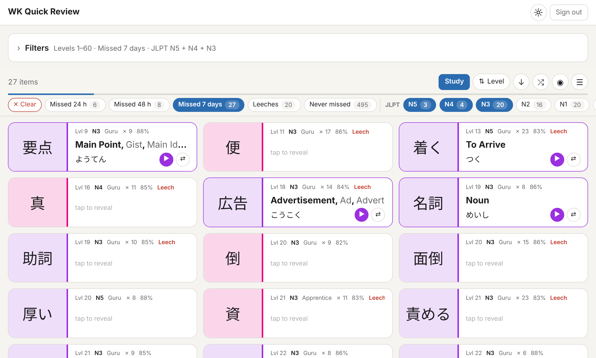

# WaniKani Quick Review

A fast, no-install review list for your [WaniKani](https://www.wanikani.com/) radicals, kanji and vocabulary.
Each card shows the Japanese; tap it to reveal the meaning and reading. Filter by your mistakes, leeches, SRS stage,
JLPT level or frequency, then go through the list or study it one card at a time.

**Open it: <https://maxme.github.io/wanikani-quick-review/>** — all you need is a WaniKani API token.



It is a static page (HTML, CSS and plain JavaScript, no build step, no server). It reads your data from the WaniKani
API and never writes to it: your reviews and SRS progress are left untouched.

## Features

**Review list**
- Meaning and reading stay hidden until you tap a card (tap again to hide them). Radicals have no reading.
- The pronunciation plays when a card is revealed (can be turned off), with a button to replay it.
  Vocabulary uses WaniKani's recordings (with a button to switch voice actor). Kanji have no recording, so their
  primary reading is spoken by the browser's speech synthesis, which needs a Japanese voice on the device
  (included on iOS, macOS, Android and Windows with the Japanese language pack). Not offered in Firefox on macOS, which adds a sound at the end of every reading.
- Each card shows its level, JLPT level, SRS stage and, once missed, its number of misses and overall % correct.
- Compact view, one to three columns depending on the screen, light and dark themes, 1,000 items per page.
- Keyboard: ↑/↓ (or k/j) to move between cards, Space or Enter to reveal.

**Filters**: every filter is a group of chips that applies at once.
Chips of one group add up (N5 + N4); groups combine (N5 + N4 *and* missed this week). No chip in a group means no
constraint, and each chip shows how many items it would match. The groups:

| Group | Chips |
| --- | --- |
| Type | Radicals, kanji, vocabulary (kana-only vocabulary included) |
| Level | Min and max level |
| SRS stage | Not started, Apprentice, Guru, Master, Enlightened, Burned |
| Reviews | Available now |
| Mistakes | Missed in the last 24 h, 48 h or 7 days, leeches, never missed (see [below](#mistakes-and-leeches)) |
| JLPT | N5 to N1, not in the JLPT lists |
| Frequency | Top 500, 501–1,000, … 5,001–10,000, rarer (pick several to get a top N) |
| School grade | Grade 1 to 6, secondary school, jinmeiyō, not jōyō (for a word: its hardest kanji) |
| Word type | Nouns, verbs (godan, ichidan, する, transitive, intransitive), adjectives, adverbs, counters… |

The mistake and JLPT chips also sit above the list. JLPT, frequency, grade and word type leave radicals out.

**Order**: level (WaniKani order), most misses, hardest (leech score), recently missed, JLPT, frequency, SRS stage,
next review or random, and a button to reverse it.

**Study mode**: goes through the current list one card at a time, in its current order.
Reveal with Space, ← or →, then answer *Didn't know* (1 or ←) or *Knew it* (2 or →).
The results show your score, the time spent, and the missed cards with their answers, ready to be studied again;
leaving early shows the results so far. A study can be paused and resumed later in the same browser.
With **Timed** (a button in the study view, or T), each card gets 10 seconds; a card left unanswered counts as *Didn't know*.
The choice is remembered. It is only available during a study.
These answers are only for you: nothing is sent to WaniKani.

## Privacy and API use

- The **API token** is stored in your browser (`localStorage`) and only sent to `api.wanikani.com`. A read-only token
  is enough: create one in WaniKani under *Settings → API Tokens*. *Sign out* removes it.
- Your **data** (subjects, assignments, review statistics) is cached in your browser (IndexedDB and `localStorage`),
  so later visits only ask WaniKani for what changed since the last one, usually three small requests.
  *Sign out* clears this cache too.
- No analytics, no tracking, no server of its own. Besides the WaniKani API, the page loads the Noto Sans JP font from
  Google Fonts and its own static files from GitHub Pages; audio files and radical images come from WaniKani
  (`files.wanikani.com`).

## Mistakes and leeches

The WaniKani API no longer gives the time of each answer (`GET /reviews` is deprecated and returns nothing),
so recent mistakes are deduced from the review statistics:

- During a review, a part (meaning or reading) answered wrong must be answered again until it is right, so its
  current streak of correct answers ends at 1. A streak of 1 on a part that has wrong answers therefore means
  **the last review of the item had a miss**, and the statistic's `data_updated_at` is the time of that review.
- **Missed in the last 24 h / 48 h / 7 days**: the last review had a miss and took place in that period.
  A miss followed by a correct review within the same period is not visible anymore.
- **Leech**: at least 10 misses in total, a leech score of 4 or more, and not burned. The leech score is the one
  used by the community *Leech Training* script: for the meaning and the reading,
  `incorrect / current_streak ^ 1.5`, keeping the higher one. It is high for items missed often *and* recently.
  The overall % correct is not used, as it stays between 80% and 90% for almost every item once an account has
  many reviews. The thresholds are at the top of `app.js`.
- **Never missed**: answered at least once, never wrong.

## JLPT, frequency and school grade

WaniKani does not provide these, so they come from `data/japanese.json`, built from open data by
`scripts/build_japanese_data.py`:

| | Kanji | Vocabulary |
| --- | --- | --- |
| JLPT | Jonathan Waller's lists, via [kanji-data](https://github.com/davidluzgouveia/kanji-data) | Jonathan Waller's lists, via [yomitan-jlpt-vocab](https://github.com/stephenmk/yomitan-jlpt-vocab) (linked to JMdict entries) and [open-anki-jlpt-decks](https://github.com/jamsinclair/open-anki-jlpt-decks) |
| Frequency | Newspaper rank (KANJIDIC, top 2,500) | JMdict newspaper frequency bands (500 words each) |
| School grade | KANJIDIC | Grade of the word's hardest kanji |
| Word type | – | WaniKani parts of speech |

The JLPT has published no official lists since 2010; Waller's lists are the usual reference (they are also used by
jisho.org and wkstats). A word gets a level when both its WaniKani spelling **and** reading match a listed word
(日 read ひ is N4, 日 read にち is N3). Otherwise, the level of the same JMdict entry is used, so a word listed in kana
only (おととし) still gives its level to its kanji spelling (一昨年). About 3,800 of the 6,800 WaniKani words are on
the lists.

To rebuild the file (the token is only read from the environment and sent to `api.wanikani.com`):

```bash
WANIKANI_TOKEN=your-token python3 scripts/build_japanese_data.py
```

## Development

```text
index.html                      the page
app.js                          all the logic (API, cache, filters, cards, study mode)
styles.css                      styles, light and dark themes
data/japanese.json              JLPT, frequency and grade data (generated)
scripts/build_japanese_data.py  builds data/japanese.json
.github/workflows/pages.yml     deploys to GitHub Pages
```

There is no build step or dependency. Serve the folder with any static server, for example:

```bash
python3 -m http.server 8000
```

then open <http://localhost:8000>.

Every push to `main` deploys the site with GitHub Actions (*Settings → Pages → Source: GitHub Actions*). Only the files
the site uses are published.

## Known limits

- Recent misses are deduced, see [above](#mistakes-and-leeches): only the last review of each item is known.
- Radicals without a text character are shown with their WaniKani image.
- "Available now" reflects the time the list was loaded.
- The WaniKani API allows 60 requests per minute; the app waits and retries when the limit is reached.
  The first visit downloads everything (about 30 requests), later ones only the changes.

## Credits and license

- Not affiliated with WaniKani or Tofugu. WaniKani content (meanings, readings, audio, radical images) comes from
  your account through the WaniKani API.
- KANJIDIC and JMdict © [EDRDG](https://www.edrdg.org/), CC BY-SA 4.0. JLPT lists by Jonathan Waller
  ([tanos.co.uk](http://www.tanos.co.uk/jlpt/)), CC BY. See the projects linked above for the derived data.
- Code under the [GNU GPL v3](LICENSE).
